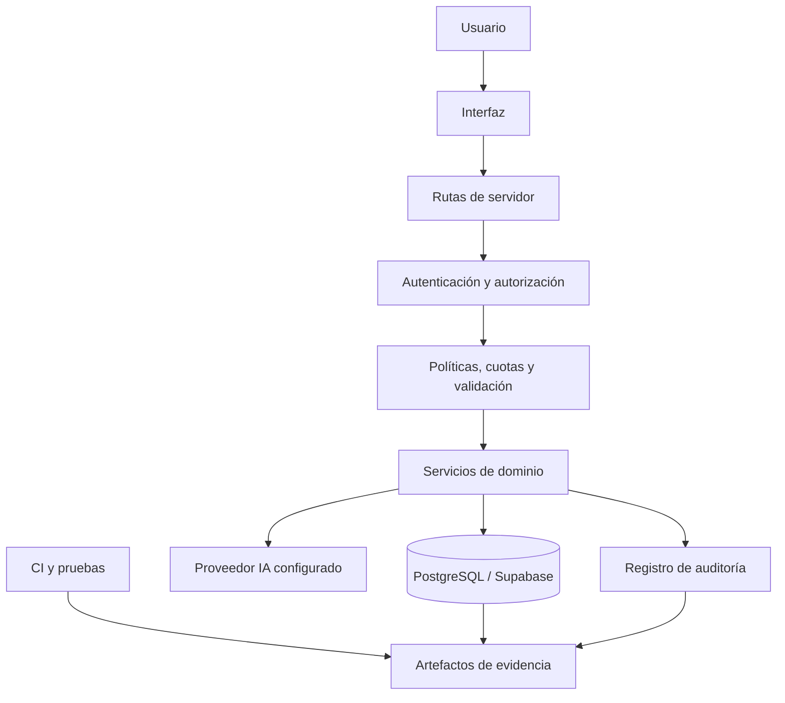

# Arquitectura general

## Capas

1. **Interfaz web** — React, TypeScript, TanStack Start/Router y componentes del sistema de diseño.
2. **Capa de rutas** — páginas y handlers HTTP. Las rutas de servidor deben validar método, tipo y tamaño de entrada, autenticación, autorización, cuota y errores.
3. **Servicios de dominio** — gobernanza, catálogo de skills, cuotas, auditoría y lógica de negocio.
4. **Persistencia** — Supabase/PostgreSQL y migraciones versionadas. El esquema SQL conserva las restricciones de seguridad que el mapeo ORM no representa.
5. **Proveedores externos** — IA, autenticación y, cuando se implemente, facturación. Las claves privadas son solo de servidor.
6. **Evidencia y entrega** — pruebas, inventarios, manifests, CI, firma y documentación de release.

## Límites de confianza

## Estado de capacidad

- **Contrato de skill:** describe entradas, salidas y límites; no implica ejecución.
- **Blueprint:** propuesta para desarrollo futuro; no debe anunciarse como funcionalidad operativa.
- **Implementación:** código integrado; aún necesita pruebas y permisos verificados.
- **Aceptada en producción:** requiere evidencia reproducible de build, pruebas, integración, seguridad, observabilidad, recuperación y configuración real.
- **Release firmado:** requiere verificación criptográfica; un marcador pendiente no equivale a firma.

## Reglas de cambio

- No confiar en controles de frontend para autorización.
- No usar una clave de servicio para eludir RLS sin una frontera de autorización explícita.
- Mantener migraciones SQL y modelos Drizzle alineados.
- Tratar el contenido del usuario y el contexto de navegación como datos no confiables para el asistente.
- Evitar side effects de pago sin confirmación, idempotencia y verificación de webhook.
- Registrar la evidencia y el resultado real de las pruebas; nunca inferir que un servicio externo funciona a partir del código.
